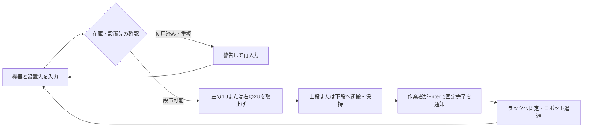

# ラック搭載支援ロボットデモ

**機器を支える役をロボットへ。作業者1名とロボットで、ラックへの搭載作業を進めるシミュレーションです。**

データセンタでサーバなどをラックへ取り付ける場面を題材に、ロボットが機器を取り上げ、指定された高さで保持し、人によるねじ止めの完了後に退避するデモを制作しました。Gazebo上のCRANE+ V2に昇降軸と支持治具を追加した、卓上サイズのモデルです。

[実行・操作ガイド](rack_demo/README.md) · [保存済みの検証結果](rack_demo/validation/collision_enabled/session_audit.json)

## 解決したい課題

本デモでは、ラック搭載時に「機器を支えて位置を合わせる人」と「ねじ止めする人」の2名が必要な作業を想定しています。ロボットが運搬・保持を担当し、人がねじ止めと作業完了の判断を担当することで、人とロボットの役割分担を示します。

| 担当 | デモ内での役割 |
|---|---|
| 作業者 | 機器と設置先を指定し、ねじ止め完了の想定でEnterを押す |
| ロボット | 機器を取り上げ、指定位置まで運び、保持した後に退避する |
| 制御プログラム | 在庫・設置先・動作経路を確認し、衝突する指令を拒否する |

## どのように動くか

起動時から、ロボットの左側に1U相当、右側に2U相当の機器が各1台あります。「1U・2U」は、ここでは厚さの異なる2種類の機器モデルを表します。



各動作の送信前には、ハンド・治具・機器・ラックなどの衝突を検査します。

### 見どころになる操作例

| 順番 | 入力する指示 | 確認できる動作 |
|---|---|---|
| 1 | `1u` → `lower` | 左の機器を取り上げ、下段で保持。Enter後に固定・退避 |
| 2 | `2u` → `lower` | 下段に1台目があるため、取りに行く前に警告 |
| 3 | `2u` → `upper` | 右の機器を上段へ設置。1台目を残したまま連続作業 |

機器は取上げ・運搬中に生成し直さず、最初に配置された同じモデルを運びます。各機器は1台ずつのため、使用済みの機器を再度取りに行くことはありません。

## 実行するには

**講義環境のDockerコンテナ `pai_ros2` が準備済みであることが前提です。このリポジトリのcloneだけでは、実行環境は構築されません。**

| 必要なもの | 本デモで使用する構成 |
|---|---|
| ホスト側 | Windows、PowerShell、Dockerを実行できる環境 |
| コンテナ内 | ROS 2 Humble、Gazebo Ignition 6、CRANE+関連パッケージ |
| 講義ワークスペース | `/home/ubuntu/airobot_ws/install/setup.bash` |
| 追加ライブラリ | `requirements_collision.txt` に記載したPythonライブラリ |
| 画面表示 | コンテナのデスクトップ表示。既存環境では `http://localhost:6080` |

講義コンテナや外部のロボットモデル・ROSパッケージは、このリポジトリには含めていません。

環境が準備できている場合は、次の順に進めます。

1. [実行ガイド](rack_demo/README.md#1-コードを取得する)に従い、コードをコンテナへコピーする。
2. **PowerShell A**でGazeboを起動し、その画面を開く。
3. **PowerShell B**で操作プログラムを起動し、機器と設置先を入力する。

Gazeboがすでに起動している場合の操作開始コマンドは、次のとおりです。

```powershell
docker exec -it pai_ros2 bash /home/ubuntu/rack_demo/run_demo.sh
```

初回起動・再開・初期化・エラー時の対応は、[実行・操作ガイド](rack_demo/README.md)を参照してください。

## 衝突対策と検証結果

アーム・ハンドの衝突メッシュと、支持治具6部品の衝突形状を有効にしています。ハンドと干渉しないようブラケットを側方へ迂回させ、上段設置後はハンド全体を引き抜いてから下降する経路にしています。

| 検証内容 | 確認した結果 |
|---|---|
| Gazeboでの連続設置 | 1U下段 → 同じ下段への2U拒否 → 2U上段を完了 |
| 使用済み位置への指示 | ロボットを動かす前に拒否。動作指令の送信回数は0 |
| 組み合わせ・順序を変えた経路検査 | 4通りの連続設置順に含まれる計8経路が通過 |
| ハンド対機器・ハンド対治具 | 故意に衝突させた隔離シーンで物理接触を確認 |
| 連続設置時の接触監視 | 監視対象では、支持パッドと機器の接触のみを記録 |

根拠となる記録は [validation/collision_enabled/](rack_demo/validation/collision_enabled/) に保存しています。8経路は計算による経路検査であり、すべてをGazebo上で実行したという意味ではありません。検証は定義した条件での機能確認です。

## AIを利用した範囲

| 観点 | 現在の状態 |
|---|---|
| 開発でのAI活用 | 生成AIによる要件整理、コード作成、不具合分析、検証処理の整備を実施 |
| ロボット動作時のAI活用 | 自然言語解釈は未実装。現在は選択入力とルールに基づいて動作 |

今後は「厚い方を上に載せて」などの指示を解釈し、機器と設置先の選択につなげる構成を想定しています。現在の逆運動学や衝突検査は、学習済みAIによる制御ではありません。

## シミュレーションの再現範囲

- 1U相当は12×19×1.8cm・50g、2U相当は12×19×3.6cm・100gのデモ用モデルです。実寸19インチ規格への適合は検証していません。
- 最初の持上げは支持パッドと機器の物理接触で行い、その後の保持はGazeboの固定ジョイントで表現します。
- ねじ止めの完了はEnter入力と固定ジョイントで表現します。実際のねじ回転、締結力、指の摩擦把持は再現していません。
- 経路検査は既知のシーンを対象とする離散的な検査です。未知の障害物の認識、動く障害物への再計画、実機での人との協働の安全性は検証していません。

## コードの読み方

最初に動作全体を追う場合は、`rack_session.py` から読むと、質問・確認・運搬・固定・退避の流れを把握できます。

| ファイル | 役割 |
|---|---|
| [rack_session.py](rack_demo/rack_session.py) | 対話入力、作業の進行、連続設置、動作指令 |
| [session_scene.py](rack_demo/session_scene.py) | 初期配置、在庫・設置状態、把持・固定ジョイント |
| [demo_scene.py](rack_demo/demo_scene.py) | ロボット・治具・機器・ラックの形状、逆運動学 |
| [collision_guard.py](rack_demo/collision_guard.py) | 自己衝突・環境・運搬機器・補間経路の検査 |
| [rack_demo.launch.py](rack_demo/rack_demo.launch.py) | Gazebo、ロボット、コントローラの起動 |
| [simulation_files.py](rack_demo/simulation_files.py) / [contact_monitor.cc](rack_demo/contact_monitor.cc) | シーン・接触センサの設定、接触記録 |

その他の実行ファイルと検証記録の説明は、[実行ガイドのファイル一覧](rack_demo/README.md#ファイル)にまとめています。
